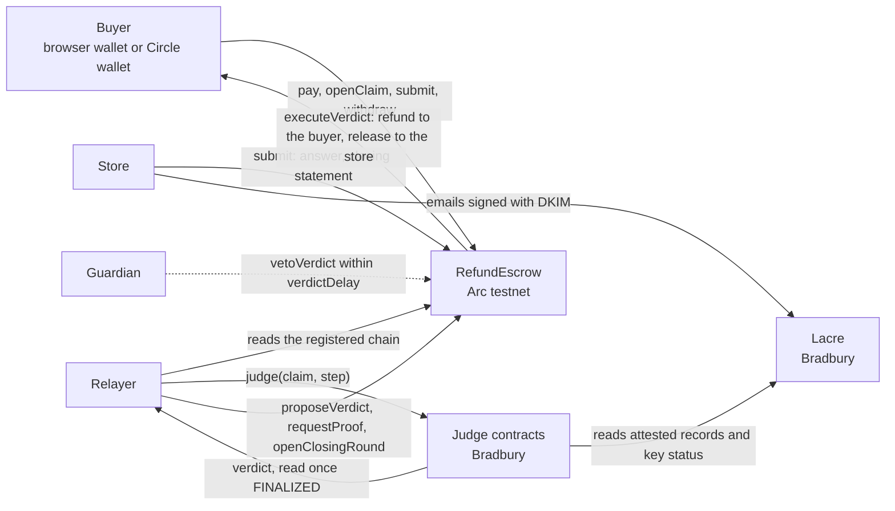

# Tenet

[](https://github.com/randyparrs/Tenet/actions/workflows/test.yml)

Buyer protection for stablecoin payments.

The money is held in escrow on Arc. If something goes wrong, a GenLayer judge decides and the escrow
carries out the verdict.

**Live page: [tenet.rpmdev.app](https://tenet.rpmdev.app)**. Its Demo Shop takes 1.00 testnet USDC
([Circle faucet](https://faucet.circle.com)) from a browser wallet or from a Circle wallet opened with
Google, lets the order go wrong, and shows the GenLayer judge's verdict and the escrow's settlement.

- Demo Shop API (the demo store and relayer, a Cloudflare Worker):
  [tenet-demo.randyparra.workers.dev](https://tenet-demo.randyparra.workers.dev/api/config)
- Email attestations: [Lacre](https://lacre.in-sidr.xyz) by Insidr Labs

## How it works

A buyer pays in USDC into `RefundEscrow` on Arc testnet. The store answers claims within a deadline;
the store's own emails, signed with DKIM, are attested on Lacre and count as evidence. Each claim step
goes to a judge contract on GenLayer Bradbury, and the escrow pays out the verdict the judge reached
in final state.

There are three claim paths: `late` (the email judge reads the store's signed emails),
`not_as_described` and `not_delivered` (the subjective judge reads the claim and the store's answer).
The language models only answer closed questions about texts; the rules of procedure, deadlines and
amounts are in code.

## Architecture



| Part | Where | What it does |
|---|---|---|
| `RefundEscrow` | Arc testnet (`evm/src/RefundEscrow.sol`) | Holds each order's USDC; checks on chain that a claim names its own order and that each input comes from the right party; registers every input in a hash chain; pays out only a verdict for the chain the judge saw; pull payments |
| Email judge | Bradbury (`contracts/judge_mail.py`) | `late` claims: reads the store's emails attested on Lacre through its router, checks the body against the signed body hash and the key status, and applies the store's terms in code |
| Subjective judge | Bradbury (`contracts/judge_subjective.py`) | `not_as_described` and `not_delivered`: the validators answer closed questions about the claim and the store's answer; the outcome, the refund and the next step are computed in code |
| Lacre | Bradbury (router `0xEf37...c8d9`) | Verifies the DKIM signature and domain alignment of an email's headers and keeps a record per attestation, with a key cache that checks the domain's published key |
| Relayer | `relayer/e2e.py` (live test), `worker/` (Demo Shop) | Sends each judgment step, waits for its transaction to be FINALIZED, and carries the verdict to the escrow. It cannot alter what the buyer or the store registered: the escrow rejects a verdict for any other chain or claim |
| Page | `site/` | The live test, the measurements and the Demo Shop (see Frontend) |

The life of a claim:

1. The buyer pays into the escrow with the store's terms hash. Without a claim, the store is paid when
   the holding period ends (`releaseExpired`).
2. The buyer opens a claim: the JSON the judge reads. The store answers within `RESPONSE_WINDOW`, or
   anyone registers `no_response` after it.
3. The relayer sends what was registered to the judge. The verdict is `REFUND`, `DENY`,
   `INVALID_CLAIM` or `NOT_YET` with one next step: request proof from the buyer (`PROOF_WINDOW`) or
   open a closing round where each side speaks once (`CLOSING_WINDOW`). What follows goes to the judge
   as the next step of the same chain.
4. A final verdict is proposed on the escrow, waits `verdictDelay` (the guardian can veto it) and is
   then executed by anyone. The store can refund in full at any time (`merchantRefund`); if requested
   proof never arrives, the store is paid (`releaseUnproven`); without a final verdict 60 days after
   the claim, anyone releases the order to the store.

## Demo mode and real deadlines

### Built for real deadlines

Tenet is built for the deadlines of a real payment method. The escrow enforces three of them:

| Deadline | Value | Escrow constant |
|---|---|---|
| The store answers a claim | 72 hours after the claim | `RESPONSE_WINDOW` |
| The buyer sends requested proof | 7 days after the request | `PROOF_WINDOW` |
| Each side answers the closing round | 72 hours after it opens | `CLOSING_WINDOW` |

Each store adds its own policy, in days. The live test uses a test store named Demo Shop
(`shop.rpmdev.app`; the name is part of its signed terms). Its terms: 50% refund if the order arrives
more than 2 days late, full refund if it has not arrived 10 days after the promised date, claims within
30 days of delivery, and payments held in escrow for 30 days. A proposed verdict waits 10 minutes on
testnet before it can be executed (`verdictDelay`).

### The live test runs on those deadlines

Cases A to E run on escrow v3 and the deployed judges with the real deadlines, so the test lasts days
(from 2026-10-13 to 2026-10-27). The page's Live cases screen shows each case's full timeline.

| Case | Path | Status | Transactions |
|---|---|---|---|
| A | Late delivery, partial refund | Settled: REFUND 2.00 USDC (3 days late, 50% by the store's terms), 2.00 USDC released to the store | [payment](https://explorer.testnet.arc.io/tx/0x1db750230b14f0ddea63d9bb71534a96cf86bc751397d3e6a58b1df7c71c4414), [order email attested on Lacre](https://explorer-bradbury.genlayer.com/tx/0x7e9e4353e17e3784eeffb4505d62fc96129e5eefce1d1ab7d8198de40b3e556c), [delivery email attested on Lacre](https://explorer-bradbury.genlayer.com/tx/0x41d012f722f802cde9b0e1ca4eb88862f6cf304548b1ba4460d9ac020657d5a0), [claim](https://explorer.testnet.arc.io/tx/0x81daaf9b13e34b81c1da3cb204d7f85bc139b85ef30fead20680eb0b5f8a155a), [judge step 1: REFUND 2.00 USDC](https://explorer-bradbury.genlayer.com/tx/0x0d614e404d1cbf7e1d4fb951d4d58b726c8743c95e951f57dbcb873f2268d329), [execution](https://explorer.testnet.arc.io/tx/0x3ae4a91d908be2edaffbed4498aaee22f872bab5f950d1797218b208bb45500e) |
| B | Not as described, store disputes | Settled: DENY, 3.00 USDC released to the store | [payment](https://explorer.testnet.arc.io/tx/0xc159115662c3d62be8a486f7f86f06d2351a25259ae092fe93921451afad4cc5), [claim](https://explorer.testnet.arc.io/tx/0x98f0d938f239f005e2b8853cc4b9d8d6a7fc3728c1f34907d41ee43becde7b09), [judge step 1: NOT_YET, closing round](https://explorer-bradbury.genlayer.com/tx/0xf6dbc253ac183dc1d7a08e80df36188fbc346aa005e06ad13356b64e43e6a7b9), [judge step 2, attempt 1: no consensus, resent](https://explorer-bradbury.genlayer.com/tx/0x2213963a35305ee5bcaa9073c5ba7e06a54d462a420ba627ab83a7a1d30e00cf), [judge step 2, attempt 2: DENY](https://explorer-bradbury.genlayer.com/tx/0x83b8b3cff278439f44ac25e21c41be941c07c8e1b3c028944fc1797646405e2f), [execution](https://explorer.testnet.arc.io/tx/0x85fbed6fca7bf64b4ac93aabf97d540669459cae6b9b9277114a9c6ffb6de5e7) |
| C | Not delivered, store silent | In progress: claim on 2026-10-24, verdict on 2026-10-27 | [payment](https://explorer.testnet.arc.io/tx/0x7808daf7f813751eec7a0e73ccecba05793877350cb7fbec9cd6ed984c8f6b2d) |
| D | Proof requested, never sent | In progress: payment released to the store after 2026-10-20 15:02 UTC | [payment](https://explorer.testnet.arc.io/tx/0xf05bca43afafeaa3338e831bc0351752e09c11c57e64a05bb43682a179281364), [claim](https://explorer.testnet.arc.io/tx/0x414dd456d3b3cddd36e784ed4b1cc77a83e1ad67ff682d669d0c22a4fba5ac82), [judge step 1: NOT_YET, proof required](https://explorer-bradbury.genlayer.com/tx/0x12d87bcd0f2f22423809d0706e8ba06ecf2b1ff28a544a2c5ac267470173e91b) |
| E | Not as described, store admits | Settled: REFUND 1.00 USDC | [payment](https://explorer.testnet.arc.io/tx/0x2180d8205ea202b76cbc66cfb504966cd26b99c6c9c0f32b97351ea6985185ac), [claim](https://explorer.testnet.arc.io/tx/0x44a566bcee934dcfbd8b50ae704381c6c3cbf2fe5feb1431a489e23e2731fad8), [judge step 1: REFUND 1.00 USDC](https://explorer-bradbury.genlayer.com/tx/0x87f4559fb02114abb656c7f0c283bd9dd093d5e40635d22a6cbc69909c45969c), [execution](https://explorer.testnet.arc.io/tx/0x879943968057c338871b8b6441015b3ca67ab194a6035fd952f302d9baaf6ec2) |

### The Demo Shop runs on minutes

The page's Demo Shop section is a separate deployment of the same code, with the deadlines in
minutes, so a visitor can see the whole flow in one session: the visitor buys with their own wallet
on Arc testnet, picks one of six scenarios with texts already measured, and watches the verdict and
the settlement. Its store signs as `demo.rpmdev.app`, not as the live test store `shop.rpmdev.app`.
This is everything that changes.

**Four constants of the escrow.** `evm/demo/RefundEscrow.sol` is `evm/src/RefundEscrow.sol` with
these four lines changed, built by `tools/make_demo_escrow.py`, which fails if any other line differs.
The same 42 Foundry tests run against both (`forge test` and `FOUNDRY_PROFILE=demo forge test`;
outputs in `results/escrow-v3-forge.txt` and `results/escrow-v3-demo-forge.txt`).

| Constant | Live test | Demo Shop section |
|---|---|---|
| `RESPONSE_WINDOW` | 72 hours | 5 minutes |
| `CLOSING_WINDOW` | 72 hours | 5 minutes |
| `PROOF_WINDOW` | 7 days | 5 minutes |
| `MIN_VERDICT_DELAY` | 10 minutes | 1 minute |

**The demo store's terms.** Two rules of the live test store's policy change, and the terms text
names the 5 minute windows instead of 72 hours and 7 days:

| Rule | Live test store (`shop.rpmdev.app`) | Demo Shop section (`demo.rpmdev.app`) |
|---|---|---|
| Late delivery | refund if more than 2 days late | refund if more than 0 days late |
| Not delivered | refund from 10 days after the promised date | refund with no waiting period |
| Terms hash | `0x80941ba7c4e031c1479bc2f63e2361067cf5c5841c8b80a2b5e4e04c8f8fcf93` | `0x88d01baf6e0245d6047a8f427d784234cc0dfefd38c5354dc3b185b8ab36b20f` |

**Its own deployment values.** Each deployment has its own addresses and keys: the demo escrow takes
orders up to 1.00 USDC (5.00 in the live test) and waits 2 minutes before a verdict can be executed
(10 minutes in the live test); the demo store's DKIM key is on a domain of its own, so it counts for
no other store. The Worker takes at most 3 orders per wallet and 30 in total per UTC day, and if the
judge has not finished 6 hours after the last step of a claim, the demo store refunds the order in
full; the page names those refunds as the store's, never as a verdict.

**Nothing else changes.** The two judges are deployed from the same source files as the live ones
(SHA-256 `a1c38184e7f4bc911e4321327c501daf997a3002114f90dff47390256c26d366` for
`contracts/judge_mail.py`, `6de718a730489ec528ea76fe7aede81dd7789e1dfb1705526b4641d7ad83b46f` for
`contracts/judge_subjective.py`), with the same prompts, the same Lacre contracts and the same
measured texts. The demo store and its relayer run in a Cloudflare Worker (`worker/`); the visitor
signs only their own transactions.

## Addresses

Live test (Arc testnet and GenLayer Bradbury):

| Contract or role | Network | Address |
|---|---|---|
| RefundEscrow v3 | Arc testnet | [`0x5Bf18C9B66dF20BF2D30e08b561f65de73fA1E2D`](https://explorer.testnet.arc.io/address/0x5Bf18C9B66dF20BF2D30e08b561f65de73fA1E2D) |
| Judge: store emails (late) | Bradbury | [`0x7e3251e7A9479280a6b8c93FD2E852291abd105c`](https://explorer-bradbury.genlayer.com/address/0x7e3251e7A9479280a6b8c93FD2E852291abd105c) |
| Judge: not as described, not delivered | Bradbury | [`0x2a0126530321FF7886A568b9439d3535A27EfA91`](https://explorer-bradbury.genlayer.com/address/0x2a0126530321FF7886A568b9439d3535A27EfA91) |
| Lacre Router (email attestations) | Bradbury | [`0xEf37cb72C3A9dD6bCE2f3575B75c94C555F9c8d9`](https://explorer-bradbury.genlayer.com/address/0xEf37cb72C3A9dD6bCE2f3575B75c94C555F9c8d9) |
| Buyer | Arc testnet | [`0x3c3f857c9d193cA1FED87d0f72Fc43ACA6028B25`](https://explorer.testnet.arc.io/address/0x3c3f857c9d193cA1FED87d0f72Fc43ACA6028B25) |
| Store (Demo Shop, `shop.rpmdev.app`) | Arc testnet | [`0x13E2ddb489EE77d87846e7ba36bf5F89e8ABff32`](https://explorer.testnet.arc.io/address/0x13E2ddb489EE77d87846e7ba36bf5F89e8ABff32) |
| Signer (owner and relayer) | Arc testnet and Bradbury | [`0x0F0c950043c4D0B570fb6A7eDE0874Df96966808`](https://explorer.testnet.arc.io/address/0x0F0c950043c4D0B570fb6A7eDE0874Df96966808), [on Bradbury](https://explorer-bradbury.genlayer.com/address/0x0F0c950043c4D0B570fb6A7eDE0874Df96966808) |

Demo Shop section (Arc testnet and GenLayer Bradbury):

| Contract or role | Network | Address |
|---|---|---|
| RefundEscrow v3, demo build | Arc testnet | [`0x185D7aaFE85823a2B91D00735CF9f312E1dAc709`](https://explorer.testnet.arc.io/address/0x185D7aaFE85823a2B91D00735CF9f312E1dAc709) |
| Judge: store emails (late) | Bradbury | [`0x503E73e0Fb2B85C2027Eef457417796D499511E4`](https://explorer-bradbury.genlayer.com/address/0x503E73e0Fb2B85C2027Eef457417796D499511E4) |
| Judge: not as described, not delivered | Bradbury | [`0x68e180057AE598301b94a0737309fE00a1ca7D3f`](https://explorer-bradbury.genlayer.com/address/0x68e180057AE598301b94a0737309fE00a1ca7D3f) |
| Lacre Router (email attestations) | Bradbury | [`0xEf37cb72C3A9dD6bCE2f3575B75c94C555F9c8d9`](https://explorer-bradbury.genlayer.com/address/0xEf37cb72C3A9dD6bCE2f3575B75c94C555F9c8d9), shared |
| Demo store (`demo.rpmdev.app`) | Arc testnet | [`0x7bB6c50dC82151226d8253CC0C5a9088Cd4ef1E2`](https://explorer.testnet.arc.io/address/0x7bB6c50dC82151226d8253CC0C5a9088Cd4ef1E2) |
| Demo relayer | Arc testnet and Bradbury | [`0x09eA4087B9245E1EfB95aCbA437FD1Ff8B4A0D63`](https://explorer.testnet.arc.io/address/0x09eA4087B9245E1EfB95aCbA437FD1Ff8B4A0D63), [on Bradbury](https://explorer-bradbury.genlayer.com/address/0x09eA4087B9245E1EfB95aCbA437FD1Ff8B4A0D63) |

Networks: Arc testnet (chain 5042002, RPC `https://rpc.testnet.arc.io`, explorer
[explorer.testnet.arc.io](https://explorer.testnet.arc.io)) and GenLayer Bradbury (chain 4221, RPC
`https://rpc-bradbury.genlayer.com`, explorer
[explorer-bradbury.genlayer.com](https://explorer-bradbury.genlayer.com)).

## Frontend

The page at [tenet.rpmdev.app](https://tenet.rpmdev.app) is static HTML, CSS and plain JavaScript
(`site/`, no framework and no build step), served by Cloudflare Pages. Every number on it is read from
`site/data/tenet.json`, which `tools/make_site_data.py` builds from the logs in `results/`.

- **Overview, How it works, Order flow**: the problem, the three networks, and an order as the buyer
  and the store see it.
- **Live cases and Case detail**: cases A to E of the live test, each transaction with its explorer
  link, the deadlines counting down and the verdicts as the judge returned them.
- **Judges on GenLayer and Measurements**: the Bradbury run and the local committee measurements
  behind every text the judges read.
- **Contracts and policy, Resources**: addresses, code hashes, the store's terms and links.
- **Demo Shop**: six products, one per scenario (late delivery; not as described with the store
  admitting, disputing, or the claim lacking proof; not delivered with the store answering or silent).
  Buy creates the order and pays it in one click; a panel shows the wallet, what the escrow holds and
  what is credited, with Withdraw.
- **My orders**: every order the connected wallet paid, read from the Worker by address, so it shows from
  any browser; each order with its number, a five step track (Paid, Claim, Store answer, Judge,
  Settled; late orders show the store's emails with their Lacre attestations), one status line with a
  time bar, and the one next action ("Open a claim", "Send your answer", "Go to withdraw").

Wallets: "Connect" offers a browser wallet on Arc testnet or "Continue with Google", which opens a
Circle user-controlled wallet; each transaction is approved in Circle's window, and the Worker only
builds challenges for the Demo Shop's own calls. Privacy:
[tenet.rpmdev.app/privacy](https://tenet.rpmdev.app/privacy).

Run it locally from the repository root, then open `http://127.0.0.1:8000`:

```
python -m http.server 8000 --bind 127.0.0.1 --directory site
```

## Repository layout

| Path | What it is |
|---|---|
| `evm/` | Foundry project: `src/RefundEscrow.sol` (escrow v3, live test), `demo/RefundEscrow.sol` (demo build), `test/` (42 tests) |
| `contracts/` | The two GenLayer judge contracts, their templates and `build_judge_v2.py`, which builds them; `ERRORS.md` lists their error codes |
| `arbiter/` | The rules and prompts the judges are built from, as plain Python modules; `lacre_vendor/` holds two files copied from Lacre |
| `relayer/` | `e2e.py` (the live test, one command per step) and `demo_setup.py` (one-time setup of the demo contracts) |
| `worker/` | The Demo Shop's store and relayer, a Cloudflare Worker, and its local rehearsal (`test/rehearsal.mjs`) |
| `site/` | The static page (plain JavaScript); `data/tenet.json` is built by `tools/make_site_data.py` from the logs |
| `tools/` | Deploy, attestation, email signing and data building tools |
| `tests/` | Local runs: the judges in Lacre's simulated GenVM SDK, the end-to-end rehearsal and the committee measurements |
| `cases/` | Measured claim texts, store emails and the Bradbury run cases |
| `results/` | Logs and reports (see below) |
| `.github/workflows/` | CI: `test.yml` runs the tests below on every push |

## Running it locally

Requirements:

- [Foundry](https://getfoundry.sh) (forge and anvil); the Solidity libraries are git submodules
  (`git submodule update --init`).
- Node.js (tested with 24); `npm install` in `worker/`.
- Python 3.12 with `genlayer-py==0.16.3`, `web3`, `eth-account`, `requests` and `truststore`.
- A clone of [Lacre](https://github.com/eudomar500/lacre) (commit `d2cb1fc1`): its simulated GenVM
  SDK and tools are used by the tests.
- `local.env`: copy `local.env.example` and set the paths. `tools/lacre_boot.py` loads it.

No command below sends a transaction:

```
cd evm && forge test && FOUNDRY_PROFILE=demo forge test
python tests/test_claim_flow.py
python tests/test_resolve_date.py
python tools/lacre_boot.py tests/judge_v2_stub_run.py
python tools/lacre_boot.py tests/e2e_rehearsal.py
VENV_PY=<that python> node worker/test/rehearsal.mjs
```

- `tests/judge_v2_stub_run.py`: both judge contracts as built, in Lacre's simulated SDK: every path and
  error code, and equivalence with the modules in `arbiter/`.
- `tests/e2e_rehearsal.py`: the live test's cases A to E on anvil, in calendar order with the clock
  moved forward, through the same commands of `relayer/e2e.py`.
- `worker/test/rehearsal.mjs`: the demo Worker on anvil with simulated judges and Lacre: the six
  scenarios, restarts, limits, the stall refund, isolation from the live test, and the page's
  Demo Shop driven end to end.

CI (`.github/workflows/test.yml`) runs all of the above on every push, plus the Worker's Circle
routes against a simulated Circle API (`worker/test/circle.test.mjs`).

The committee measurements (`tests/run_local_*.py`) call 5 models through OpenRouter and need
`OPENROUTER_API_KEY`; their outputs are already in `results/`.

## Results

| File | What it holds |
|---|---|
| `results/e2e-log-en.jsonl` | The live test log: every transaction of cases A to E. A copy of the raw log, written by `tools/make_site_data.py`, with the labels of the two `checks` rows translated from Spanish; values unchanged |
| `results/br-log.jsonl` | The Bradbury run: 10 cases through both deployed judges, 10 of 10 as expected |
| `results/attest-mail.jsonl`, `results/attest/` | Lacre attestations of the live test store's emails |
| `results/demo-log.jsonl`, `results/demo-judges-log.jsonl` | Setup of the Demo Shop section's contracts |
| `results/local-c3.jsonl`, `local-nd.jsonl`, `local-b3.jsonl`, `local-k17b.jsonl`, `local-g1d.jsonl` | Every reading of the local committee measurements, with their reports (`*-report.txt`) |
| `results/escrow-v3-forge.txt`, `results/escrow-v3-demo-forge.txt` | Foundry runs of both escrow builds |
| `results/judge-v2-local.txt`, `results/e2e-rehearsal.txt`, `results/demo-rehearsal.txt` | Outputs of the local runs above |
| `results/dkim-public-*.txt` | The public DKIM records of the test store domains |

## Sources

- Arc: [documentation](https://docs.arc.network),
  [connect to Arc](https://docs.arc.network/arc/references/connect-to-arc),
  [contract addresses](https://docs.arc.network/arc/references/contract-addresses),
  [explorer](https://explorer.testnet.arc.io).
- Circle: [USDC](https://developers.circle.com/stablecoins/what-is-usdc),
  [faucet](https://faucet.circle.com),
  [user-controlled wallets](https://developers.circle.com/wallets/user-controlled),
  [social login](https://developers.circle.com/wallets/user-controlled/create-user-wallets-with-social-login),
  [Web SDK](https://developers.circle.com/wallets/user-controlled/web-sdk).
- GenLayer: [protocol](https://docs.genlayer.com/understand-genlayer-protocol),
  [Intelligent Contracts](https://docs.genlayer.com/developers/intelligent-contracts/introduction),
  [equivalence principle](https://docs.genlayer.com/developers/intelligent-contracts/equivalence-principle),
  [Bradbury explorer](https://explorer-bradbury.genlayer.com),
  [genlayer-js](https://github.com/genlayerlabs/genlayer-js),
  [genlayer-py](https://github.com/genlayerlabs/genlayer-py).
- Lacre: [lacre.in-sidr.xyz](https://lacre.in-sidr.xyz), [source](https://github.com/eudomar500/lacre).
- Email authentication: [DKIM, RFC 6376](https://www.rfc-editor.org/rfc/rfc6376),
  [DMARC identifier alignment, RFC 7489](https://www.rfc-editor.org/rfc/rfc7489).
- Cloudflare: [Workers](https://developers.cloudflare.com/workers/),
  [Durable Objects](https://developers.cloudflare.com/durable-objects/),
  [Cron Triggers](https://developers.cloudflare.com/workers/configuration/cron-triggers/),
  [Pages](https://developers.cloudflare.com/pages/).
- Tooling: [Foundry](https://getfoundry.sh),
  [OpenZeppelin Contracts 5.x](https://docs.openzeppelin.com/contracts/5.x/), [viem](https://viem.sh),
  [Google OAuth 2.0](https://developers.google.com/identity/protocols/oauth2),
  [OpenRouter](https://openrouter.ai) (local committee measurements).

## License

MIT. See [LICENSE](LICENSE).

## Credits

Email attestations use [Lacre](https://github.com/eudomar500/lacre) by Insidr Labs, under the MIT
license ([lacre.in-sidr.xyz](https://lacre.in-sidr.xyz)). See [NOTICE.md](NOTICE.md).
